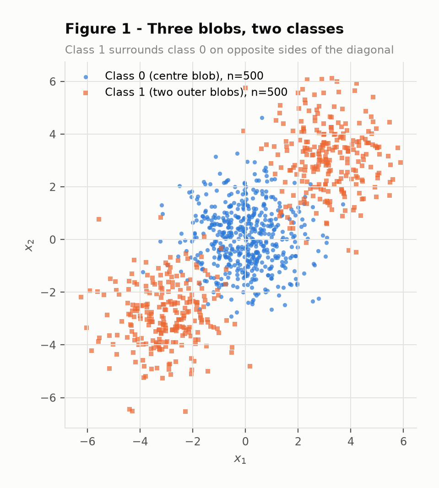
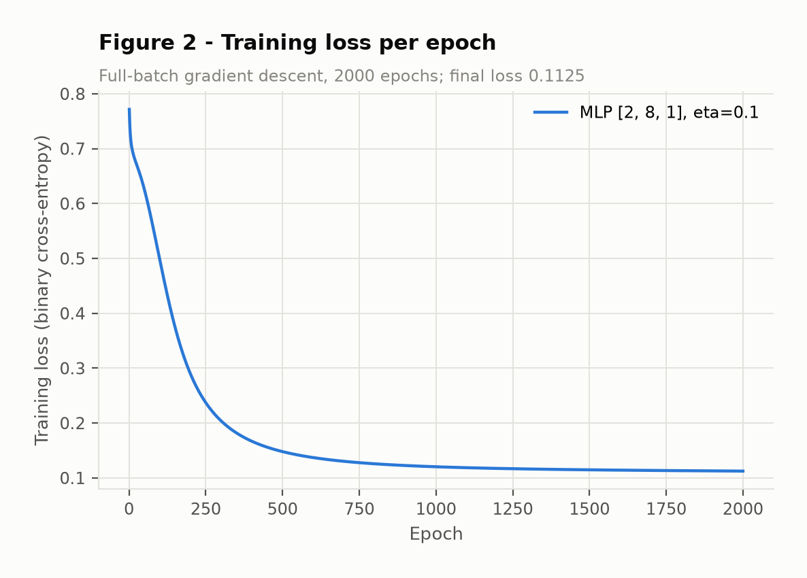
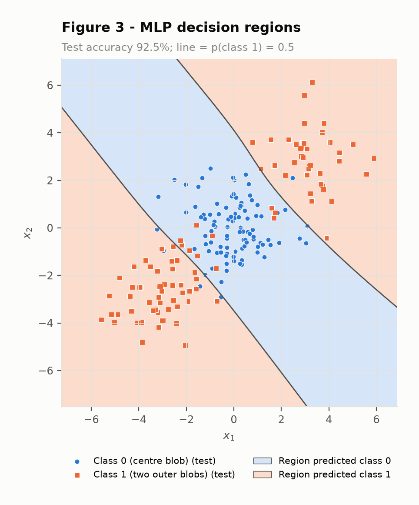
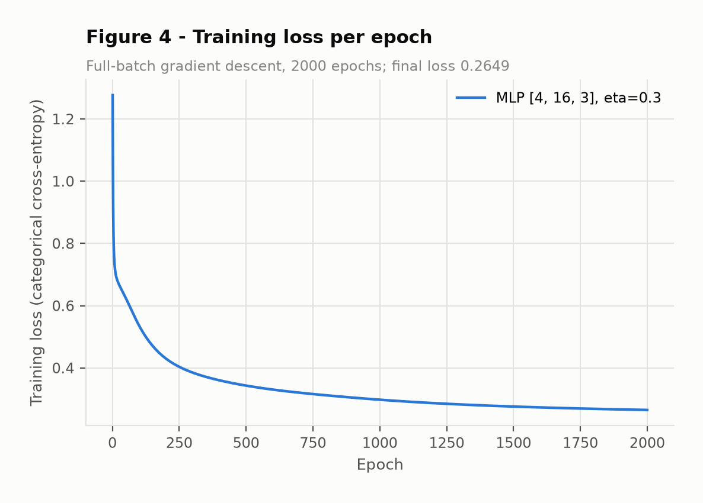
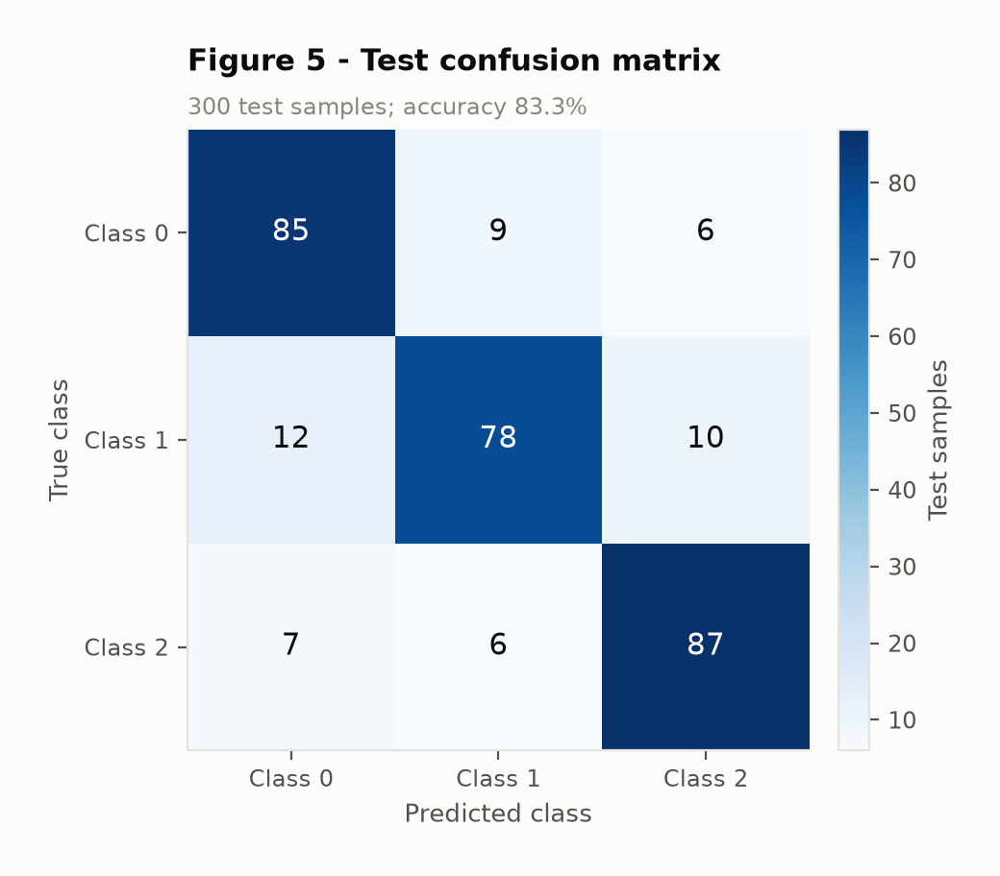
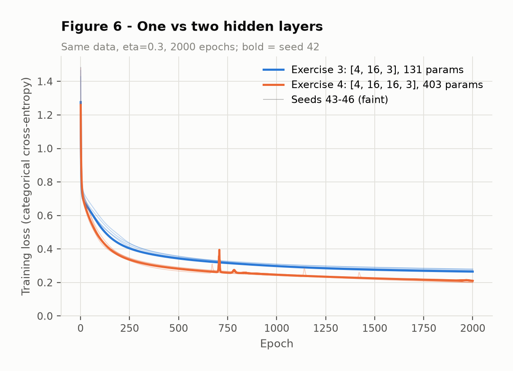

# Multi-Layer Perceptron

A perceptron can only draw one straight line. This exercise adds a hidden layer and trains it with
backpropagation: first one step by hand, then a from-scratch NumPy MLP on a binary problem no line can
solve, then the *same code* on a three-class problem, and finally a controlled test of whether a second
hidden layer is worth its cost.

Seed `42` throughout: every script creates `rng = np.random.default_rng(42)` and draws the weight
initialisation from it. The only exception is the multi-seed comparison in Exercise 4, which repeats
the training with seeds 42–46 so that the comparison is between means.

!!! info "Reproducing"
    ```bash
    git clone https://github.com/leosfreitas/ann-dl
    cd ann-dl
    pip install -r requirements.txt
    cd docs/exercises/mlp/code
    python mlp_ex1.py   # numeric check of the hand derivation -> results/mlp1.json
    python mlp_ex2.py   # Figures 1, 2, 3                      -> results/mlp2.json
    python mlp_ex3.py   # Figures 4, 5                         -> results/mlp3.json
    python mlp_ex4.py   # Figure 6, 5-seed comparison          -> results/mlp4.json
    ```
    The network itself is `code/mlp.py`: NumPy only. scikit-learn is used solely for `make_blobs`,
    `make_classification`, `train_test_split`, `confusion_matrix` and the logistic-regression
    baselines.

## Exercise 1 — One backpropagation step by hand

Network: 2 inputs → 2 `tanh` hidden neurons → 1 `tanh` output, loss `L = (y − ŷ)²` with N = 1.

```text
x = [0.5, −0.2]          y = 1.0          η = 0.3

W(1) = [[0.3, −0.1],      b(1) = [0.1, −0.2]      (row i = weights into hidden neuron i)
        [0.2,  0.4]]
W(2) = [0.5, −0.3]        b(2) = 0.2
```

All arithmetic below was done by hand and then re-checked line by line with `code/mlp_ex1.py`
(which only repeats the same formulas in NumPy). Values are rounded to 6 decimals.

### A — Forward pass

```text
z(1)_1 = 0.3·0.5 + (−0.1)·(−0.2) + 0.1 = 0.15 + 0.02 + 0.1   = 0.270000
z(1)_2 = 0.2·0.5 +   0.4 ·(−0.2) − 0.2 = 0.10 − 0.08 − 0.2   = −0.180000

h(1)_1 = tanh(0.27)  = 0.263625
h(1)_2 = tanh(−0.18) = −0.178081

u(2) = 0.5·0.263625 + (−0.3)·(−0.178081) + 0.2
     = 0.131812 + 0.053424 + 0.2                             = 0.385237

ŷ = tanh(0.385237)                                            = 0.367247

L = (1 − 0.367247)² = 0.632753²                               = 0.400377
```

### B — Backward pass

Each gradient is one application of the chain rule, using `d tanh(z)/dz = 1 − tanh²(z)`.

```text
∂L/∂ŷ    = −2 (y − ŷ) = −2 · 0.632753                         = −1.265507

∂L/∂u(2) = ∂L/∂ŷ · (1 − ŷ²) = −1.265507 · (1 − 0.134870)
         = −1.265507 · 0.865130                               = −1.094828

∂L/∂W(2) = ∂L/∂u(2) · h(1)
         = −1.094828 · [0.263625, −0.178081]                  = [−0.288624, 0.194968]
∂L/∂b(2) = ∂L/∂u(2)                                           = −1.094828

∂L/∂h(1) = ∂L/∂u(2) · W(2)
         = −1.094828 · [0.5, −0.3]                            = [−0.547414, 0.328448]

∂L/∂z(1) = ∂L/∂h(1) ⊙ (1 − h(1)²)
         = [−0.547414 · 0.930502,  0.328448 · 0.968287]       = [−0.509370, 0.318032]

∂L/∂W(1) = ∂L/∂z(1) ⊗ x          (outer product: row i = ∂L/∂z(1)_i · x)
         = [[−0.509370·0.5, −0.509370·(−0.2)],
            [ 0.318032·0.5,  0.318032·(−0.2)]]
         = [[−0.254685,  0.101874],
            [ 0.159016, −0.063606]]
∂L/∂b(1) = ∂L/∂z(1)                                           = [−0.509370, 0.318032]
```

### C — Parameter update

`θ ← θ − η · ∂L/∂θ` with η = 0.3, for all eight parameters:

| Parameter | Old | Gradient | New |
| :--- | ---: | ---: | ---: |
| W(2)₁ | 0.5 | −0.288624 | **0.586587** |
| W(2)₂ | −0.3 | 0.194968 | **−0.358490** |
| b(2) | 0.2 | −1.094828 | **0.528448** |
| W(1)₁₁ | 0.3 | −0.254685 | **0.376405** |
| W(1)₁₂ | −0.1 | 0.101874 | **−0.130562** |
| W(1)₂₁ | 0.2 | 0.159016 | **0.152295** |
| W(1)₂₂ | 0.4 | −0.063606 | **0.419082** |
| b(1)₁ | 0.1 | −0.509370 | **0.252811** |
| b(1)₂ | −0.2 | 0.318032 | **−0.295410** |

(The table lists every scalar: W(1) has 4, b(1) 2, W(2) 2 and b(2) 1.)

**Second forward pass.** With the new parameters, ŷ = **0.711181** and L = **0.083417** — the loss
goes **down**, from 0.400377 to 0.083417 (−79%). This is what a gradient step should do: every
parameter moved against its own gradient, i.e. in the direction that, to first order, decreases L.
It is not guaranteed in general — with a large enough η the step can overshoot the minimum and
increase the loss — but here η = 0.3 is small relative to the curvature, so the first-order
prediction holds. Every change also has the sign one would expect: the output was too low
(ŷ = 0.37 < 1), so b(2) and the weight on the positive hidden unit grew, and the weight on the
negative hidden unit became more negative, both pushing u(2) up.

## Exercise 2 — Binary classification a straight line cannot solve

### A — Data

`make_blobs` with centres (0,0), (3,3), (−3,−3), sizes 500/250/250, `cluster_std=1.2`,
`random_state=42`. Labels `y = (c > 0)`: the centre blob is class 0, the two outer blobs together are
class 1 — 500 points each. Split 80/20 stratified → 800 train / 200 test.



**Figure 1.** All 1000 points. Class 1 sits on *both* sides of class 0 along the diagonal. The blobs
overlap at their edges (σ = 1.2 against a centre spacing of 4.24), so some error is irreducible.

### B — Linear baseline

`LogisticRegression` on the training set: **test accuracy 47.5%** (train 52.75%). The fitted
coefficients are w = (0.0296, 0.0015), b = −0.0031 — practically zero. The model has found nothing to
separate.

### C — MLP from scratch

The whole network is in `code/mlp.py`. Layer sizes are a list argument (`sizes=[2, 8, 1]`), so depth
and width are never hard-coded; hidden layers are `tanh`, a single output unit is a sigmoid trained
with binary cross-entropy. Training is full-batch gradient descent.

| Setting | Value |
| :--- | :--- |
| Architecture | `[2, 8, 1]` — 2 inputs, 8 tanh hidden, 1 sigmoid output (33 parameters) |
| Loss | binary cross-entropy, mean over the batch |
| Initialisation | Xavier-uniform weights, zero biases, `rng = default_rng(42)` |
| Learning rate η | 0.1 |
| Epochs | 2000 (full batch → 2000 updates) |
| Training loss | 0.7717 → **0.1125** |
| Train accuracy | 96.25% |
| **Test accuracy** | **92.5%** |

The backward pass was checked against centred finite differences on random inputs before training
(max absolute error ≈ 1e-10 for both a binary and a 3-class network).

```python
--8<-- "docs/exercises/mlp/code/mlp.py"
```



**Figure 2.** Training loss per epoch. A short plateau near 0.7 (≈ log 2, i.e. guessing), a steep
drop between roughly epochs 50 and 300 while the hidden units rotate into the two boundaries, then a
long flat tail as the network refines where exactly they sit.



**Figure 3.** Decision regions over a 400×400 grid with the test points on top. The class-0 region is
a diagonal **band**; class 1 is everything on either side of it.

??? note "Script `mlp_ex2.py`"
    ```python
    --8<-- "docs/exercises/mlp/code/mlp_ex2.py"
    ```

### D — Analysis

**Why the linear model is below 50%.** A linear classifier splits the plane into two half-planes.
Class 1 lives in two blobs placed symmetrically around class 0: anything a line gains by putting the
(3,3) blob on its class-1 side, it loses by putting the (−3,−3) blob on its class-0 side. The best
half-plane is therefore no better than "always guess one class", and that is what logistic regression
converged to — weights near zero, predictions decided by noise. On a balanced test set that is a
coin flip; 47.5% is a coin flip that happened to land slightly under 50%. It is not a bug, it is the
ceiling of the hypothesis class.

**Why the MLP passes 90%.** Each tanh hidden unit is itself a soft line. The output layer combines
them, so the network can say "class 1 if beyond line A **or** beyond line B". Figure 3 shows exactly
that: the class-1 region is two disconnected half-planes on opposite sides of a band that contains
class 0, bounded by two (slightly curved) roughly parallel lines. The class-1 set is **not convex** —
the midpoint of a point at (3,3) and a point at (−3,−3) is (0,0), which is class 0 — and a single
line can only ever produce convex regions (half-planes). So no straight line can draw it; you need at
least two lines combined non-linearly, which is what one hidden layer provides. The remaining ~7.5%
error is mostly the overlap visible in Figure 1, where points of one blob sit inside another.

## Exercise 3 — Multi-class with the same network

### A — Data

`make_classification(n_samples=1500, n_features=4, n_informative=4, n_redundant=0, n_repeated=0,
n_classes=3, n_clusters_per_class=2, class_sep=1.0, random_state=42)` → class counts 499 / 499 / 502.
Split 80/20 with `random_state=42, stratify=y` → 1200 train / 300 test.

### B — Adapting the network to three classes

Three output units, softmax, categorical cross-entropy. For one sample with logits `u`, one-hot
target `y` and `ŷ_k = e^{u_k} / Σ_j e^{u_j}`:

```text
L = − Σ_k y_k log ŷ_k

Softmax Jacobian:   ∂ŷ_k/∂u_i = ŷ_k (δ_ki − ŷ_i)

∂L/∂u_i = Σ_k (∂L/∂ŷ_k)(∂ŷ_k/∂u_i)
        = Σ_k (−y_k / ŷ_k) · ŷ_k (δ_ki − ŷ_i)
        = − Σ_k y_k (δ_ki − ŷ_i)
        = − y_i + ŷ_i Σ_k y_k          (Σ_k y_k = 1 for a one-hot target)
        = ŷ_i − y_i
```

So `∂L/∂u = ŷ − y`, and for the mean over N samples, `(ŷ − y)/N`. This is **exactly** the same
expression as sigmoid + binary cross-entropy in Exercise 2 (where `∂L/∂u = ŷ − y` as well). That is
why `backward` in `mlp.py` starts from `delta = (acts[-1] - Y) / N` and serves both tasks without a
single branch — the only multi-class changes are the softmax in `forward`, the categorical form in
`loss`, and one-hot targets.

!!! success "Extra point — verbatim reuse"
    `mlp_ex3.py` imports `fit`, `predict` and `accuracy` from the same `mlp.py` that Exercise 2 uses,
    with no edits. The forward, backward and update functions are byte-for-byte the ones that trained
    the Exercise 2 network; only the arguments change (`sizes=[4, 16, 3]` instead of `[2, 8, 1]`).

### C — Training

| Setting | Value |
| :--- | :--- |
| Architecture | `[4, 16, 3]` — 4 inputs, 16 tanh hidden, 3 softmax outputs (131 parameters) |
| Loss | categorical cross-entropy, mean over the batch |
| Initialisation | Xavier-uniform weights, zero biases, `rng = default_rng(42)` |
| Learning rate η | 0.3 |
| Epochs | 2000 (full batch) |
| Training loss | 1.2767 → **0.2649** |
| Train accuracy | 90.17% |
| **Test accuracy** | **83.33%** (seed 42; mean over 5 seeds 84.33% — see Exercise 4) |



**Figure 4.** Training loss per epoch: the same shape as Figure 2 — a steep start and a long, slowly
decreasing tail.



**Figure 5.** Confusion matrix on the 300 test samples.

??? note "Script `mlp_ex3.py`"
    ```python
    --8<-- "docs/exercises/mlp/code/mlp_ex3.py"
    ```

### D — Analysis

**Most-confused pair: classes 0 and 1**, with 21 errors in total (12 true-1 predicted 0, 9 true-0
predicted 1), ahead of 1↔2 (16) and 0↔2 (13). Class 1 has the lowest recall (78/100).

The cluster structure explains it. `make_classification` places the 6 clusters (3 classes × 2) on
vertices of a 4-D hypercube with side `2·class_sep = 2`, i.e. at coordinates ±1. Recovering the
centres with a small NumPy 2-means per class gives (signs of the coordinates):

| Class | Cluster A | Cluster B |
| :--- | :--- | :--- |
| 0 | (+, −, +, +) | (−, −, −, −) |
| 1 | (−, +, +, +) | (−, +, −, −) |
| 2 | (+, +, +, −) | (−, +, −, +) |

Two vertices that differ in one coordinate are only 2 units apart; differing in two coordinates puts
them 2.83 apart. Class 1's cluster B, (−,+,−,−), is **adjacent** to class 0's cluster B (−,−,−,−)
*and* to class 2's cluster B (−,+,−,+) — each differs in a single coordinate. So class 1 is the class
sandwiched between the other two, which is why it is involved in both of the larger error counts,
while classes 0 and 2 have no adjacent pair at all (all their cluster pairs differ in ≥ 2
coordinates) and are confused least. Each cluster also has its own random covariance, so with σ ≈ 1
per cluster and only 2 units between adjacent centres, a real fraction of the points of
neighbouring clusters overlap — that part of the error no classifier can remove. Which of the two
adjacent pairs ends up worst (0–1 here with 21 errors versus 16) depends on those covariances and on
the particular 300-point test sample.

**Baseline and what the hidden layer added.** Multinomial logistic regression on the same split gets
**66.33%**; the MLP gets **83.33%** (+17 points). With two clusters per class, each class is a union
of two separated blobs, often not even on the same side of any hyperplane with respect to the other
classes — the same "class on both sides" problem as Exercise 2, now in 4-D. A linear model gives each
class one half-space-like region; the hidden layer lets the network carve each class out as the
union of two regions, one per cluster.

## Exercise 4 — Does a second hidden layer help?

Everything from Exercise 3 is kept fixed — data, split, η = 0.3, 2000 full-batch epochs,
initialisation scheme, code — and only depth changes: one more tanh hidden layer of the same width.

### A — Deeper network

| Setting | Value |
| :--- | :--- |
| Architecture | `[4, 16, 16, 3]` — two tanh hidden layers of 16 (403 parameters) |
| Learning rate / epochs | 0.3 / 2000 (identical to Exercise 3) |
| **Test accuracy (seed 42)** | **85.33%** |
| Test accuracy, mean of 5 seeds | 85.33% ± 1.70 |

### B — Controlled comparison

Both networks were trained from seeds 42, 43, 44, 45 and 46 (the seed only changes the weight
initialisation; the data and split are fixed).

| | Exercise 3 | Exercise 4 |
| :--- | ---: | ---: |
| Hidden layers | 1 × 16 | 2 × 16 |
| Parameters | 131 | 403 |
| Final training loss (mean ± sd) | 0.2735 ± 0.0063 | **0.2039** ± 0.0049 |
| Train accuracy (mean) | 90.12% | 92.68% |
| **Test accuracy (mean ± sd)** | 84.33% ± 0.97 | 85.33% ± 1.70 |
| Test accuracy per seed (42…46) | 83.3 / 85.0 / 85.7 / 83.7 / 84.0 | 85.3 / 87.3 / 82.7 / 85.3 / 86.0 |
| Train − test gap (mean) | 5.8 pts | 7.35 pts |

Mean test difference (deep − shallow): **+1.00 point**, with a per-seed standard deviation of
2.25 points; on seed 44 the deeper network is 3 points *worse*. A paired t-statistic of
1.00 / (2.25/√5) ≈ 1.0 is nowhere near significance.



**Figure 6.** Training loss of both networks on the same axes (seed 42 bold, seeds 43–46 faint).
The deeper network's loss is lower throughout — but note the spikes (seed 42 around epoch 700; other
seeds around 670, 1150 and 1420):
with the same η, the two-layer network occasionally takes a step that overshoots and has to recover.

??? note "Script `mlp_ex4.py`"
    ```python
    --8<-- "docs/exercises/mlp/code/mlp_ex4.py"
    ```

### C — Analysis

**The deeper network does not meaningfully beat the shallower one.** It gains one point on average,
well inside the seed-to-seed noise, and it is not better on every seed.

- **Cluster structure.** The problem is six roughly Gaussian blobs at hypercube vertices. Separating
  them needs a handful of hyperplanes combined — which a single hidden layer of 16 tanh units already
  provides (Exercise 3 already sits at 90% *training* accuracy). There is no hierarchical, compositional
  structure for a second layer to exploit: no "features of features". What remains is mostly the
  overlap between adjacent clusters, which no architecture can remove.
- **Representational gain vs. optimisation cost.** The second layer triples the parameter count
  (131 → 403) and does buy representational power: training loss drops 25% (0.274 → 0.204) and
  training accuracy rises 2.6 points. But the extra capacity is spent fitting the training sample more
  closely, not the underlying distribution. And it is not free to optimise: the gradient now passes
  through two tanh derivatives, and at the same η the deep network shows loss spikes (Figure 6) that
  the shallow one never does, and a larger spread of test accuracy across seeds (sd 1.70 vs 0.97).
- **Training loss vs. test accuracy.** They disagree. A 25% lower training loss translates into only
  +1.0 point of test accuracy, and the train–test gap widens from 5.8 to 7.35 points. Lower training
  loss is a statement about fit, not about generalisation; here it is mostly the early sign of
  overfitting.

**What data would reward depth.** Problems whose structure is *compositional*: images (edges →
textures → parts → objects), audio, language, or synthetic functions built by composing simple
pieces (e.g. a parity/XOR over many inputs, or nested circles). There, a deep network can represent
in few parameters what a shallow one would need exponentially many hidden units for. Six blobs in
four dimensions are not such a problem.

## Results summary

| # | Quantity | Value |
| ---: | :--- | :--- |
| 1 | Ex. 1 — z(1) and h(1) | z(1) = [0.270000, −0.180000]; h(1) = [0.263625, −0.178081] |
| 2 | Ex. 1 — u(2), ŷ, L | u(2) = 0.385237; ŷ = 0.367247; L = 0.400377 |
| 3 | Ex. 1 — updated parameters | W(2) = [0.586587, −0.358490]; b(2) = 0.528448; W(1) = [[0.376405, −0.130562], [0.152295, 0.419082]]; b(1) = [0.252811, −0.295410] (loss after the step: 0.083417) |
| 4 | Ex. 2 — linear baseline test accuracy | 47.5% (logistic regression) |
| 5 | Ex. 2 — architecture and test accuracy | `[2, 8, 1]`, tanh / sigmoid, η = 0.1, 2000 epochs → **92.5%** |
| 6 | Ex. 3 — architecture and test accuracy | `[4, 16, 3]`, tanh / softmax, η = 0.3, 2000 epochs → **83.33%** (5-seed mean 84.33%); baseline 66.33% |
| 7 | Ex. 3 — most-confused class pair | Classes **0 and 1** (21 of 50 test errors) |
| 8 | Ex. 4 — architecture and test accuracy | `[4, 16, 16, 3]`, same η and epochs → **85.33%** (seed 42; 5-seed mean 85.33%) |
| 9 | Ex. 4 — accuracy difference vs. Ex. 3 | **+1.00 point** (mean over 5 seeds; per-seed sd 2.25, not significant) |
