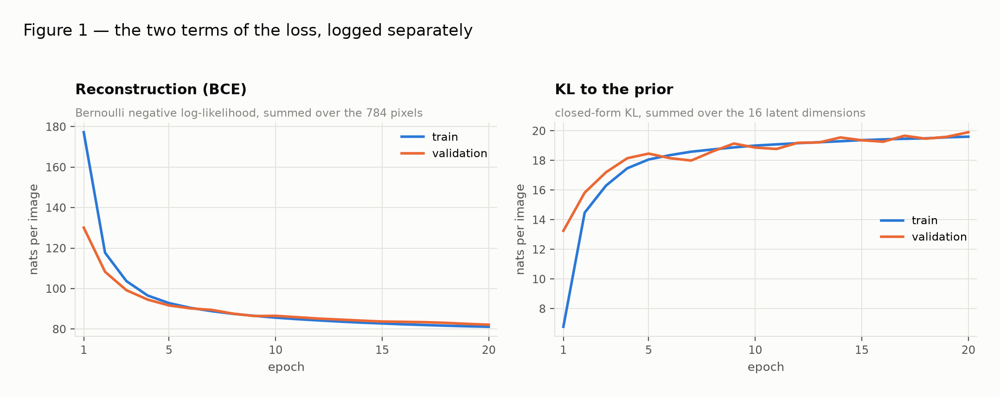
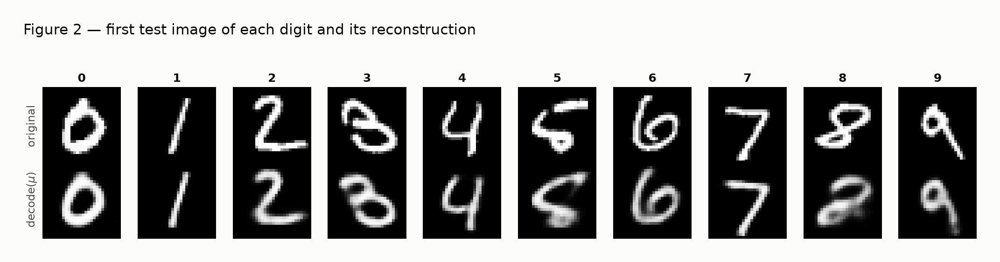
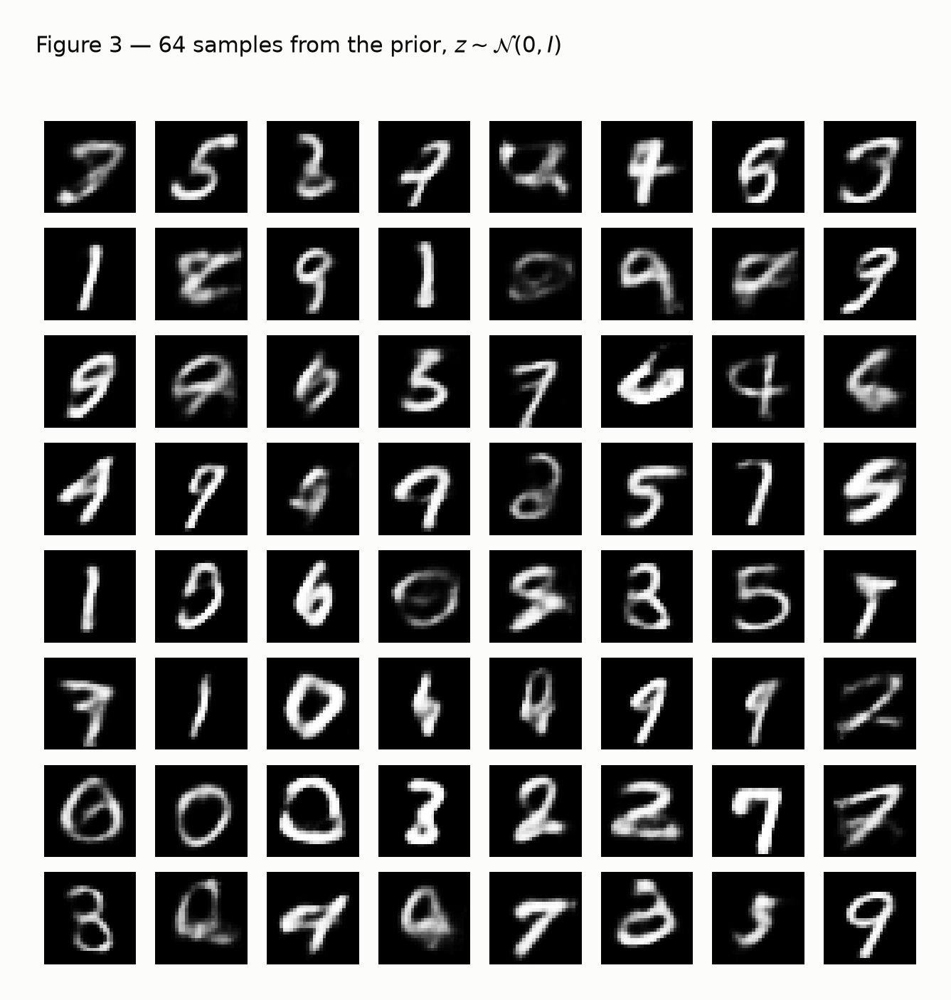
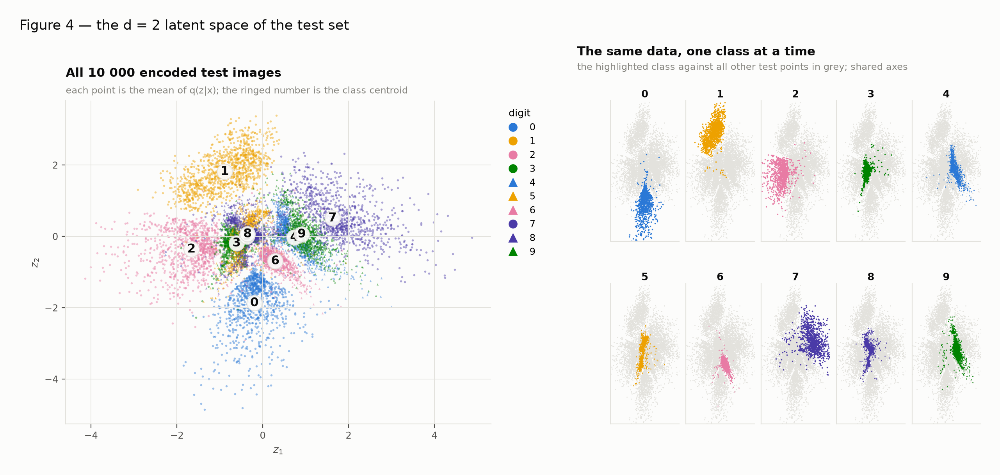
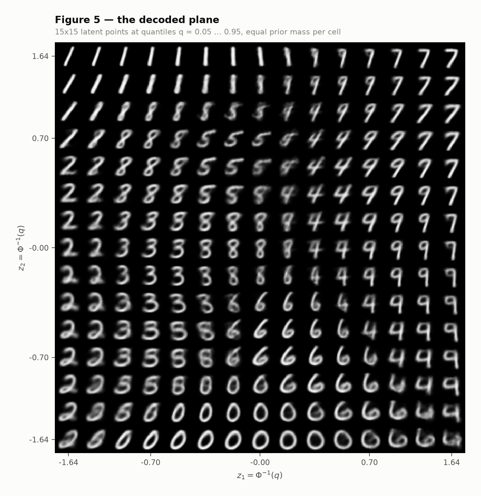
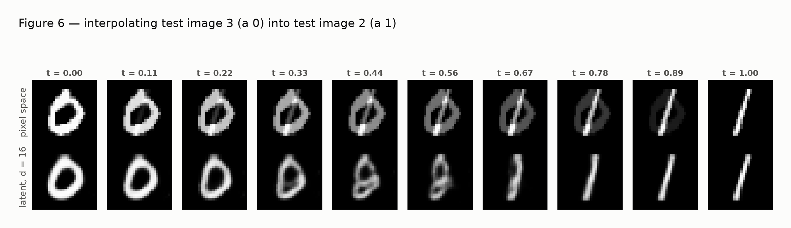

# Variational Autoencoder

A VAE pays for two things at once: reconstructing its input, and keeping its latent space close to a
prior you can sample from. This report keeps those two terms apart from the first epoch to the last,
because a total that falls says nothing about which of the two is winning. First a 16-dimensional
latent space, then a 2-dimensional one you can actually look at --- and a measurement of what that
second dimension-count costs.

Seed `42` throughout: `torch.manual_seed(42)` runs immediately before each model is built, and the
50 000 / 10 000 split uses its own generator seeded with 42. The runs are deterministic --- the
d = 16 model was trained twice while this page was being written and reported the same test
reconstruction and KL to three decimals both times.

!!! info "Reproducing"
    ```bash
    git clone https://github.com/leosfreitas/ann-dl
    cd ann-dl
    pip install -r requirements.txt
    cd docs/exercises/vae/code
    python vae_ex1.py          # d = 16: Figures 1, 2, 3 -> results/vae1.json
    python vae_ex2.py          # d = 2:  Figures 4, 5, 6 -> results/vae2.json
    python build_vae_report.py # renders ../index.md from the two JSON files
    ```
    MNIST downloads itself into `code/data/` on the first run. `vae_ex1.py` saves the trained
    d = 16 weights to `code/vae_d16.pt`, which `vae_ex2.py` reloads for the bottom row of Figure 6.
    Training took 349 s (d = 16) and 420 s (d = 2) on a laptop CPU.

    PyTorch supplies the `Linear` layers, `Adam` and autograd. The reparameterization, both terms of
    the loss and the sampling are written out in `code/vae.py`: no VAE class from a library and no
    `torch.distributions.kl_divergence`.

## Exercise 1 --- A VAE on MNIST

### A --- Load and split the data

MNIST comes from `torchvision` with pixels left in `[0, 1]` by `transforms.ToTensor()`, flattened to
784-vectors by the training loop. The 60 000 training images are split with the generator the
statement prescribes:

```python
train, val = random_split(train_full, [50_000, 10_000],
                          generator=torch.Generator().manual_seed(42))
```

That gives **50 000** training images, **10 000** validation images, and the **10 000** official test
images as the test set. Every decision during training reads the validation split; the test set is
read exactly once per model, to produce the final numbers in 1C and 2A.

??? note "`mnist_data.py`"
    ```python
    --8<-- "docs/exercises/vae/code/mnist_data.py"
    ```

### B --- Build the model

| Part | Layers |
| :--- | :--- |
| Encoder | 784 -> 512 -> 256, ReLU after each |
| Heads | two linear layers 256 -> d, one for `mu`, one for `log sigma^2` |
| Decoder | d -> 256 -> 512 -> 784, ReLU after the hidden layers, sigmoid at the output |

With d = 16 that is **1 079 600 parameters**. The loss per image, summed over the 784 pixels and
over the d latent dimensions, with `beta = 1`:

```text
L = - sum_j [ x_j log x̂_j + (1 - x_j) log(1 - x̂_j) ]            <- reconstruction (BCE)
    + beta * 1/2 sum_i ( mu_i² + sigma_i² - 1 - log sigma_i² )   <- KL
```

averaged over the images of the batch. Three pieces are written out by hand:

**The reparameterization.** `z = mu + sigma * eps` with `eps ~ N(0, I)` and `sigma = exp(logvar / 2)`.
Drawing `z` straight from `N(mu, sigma²)` would put the randomness between the parameters and the
loss, and no gradient could pass through it. Written this way the randomness is an *input*,
independent of the parameters, and `z` is a differentiable function of `mu` and `logvar`. The head
emits `log sigma²` rather than `sigma` so that it can output any real number and the variance stays
positive.

**The reconstruction term.** `F.binary_cross_entropy(..., reduction="sum")` divided by the batch
size --- summed over pixels, averaged over images. `reduction="mean"` would also average over the 784
pixels and shrink this term 784-fold against the KL, which is the same as secretly training with
`beta ≈ 784`. A Bernoulli likelihood is the right one here because the sigmoid output is a
per-pixel probability of being on, and MNIST pixels are nearly all 0 or 1.

**The KL.** The closed form for `KL( N(mu, diag(sigma²)) || N(0, I) )`, written term by term with
`sigma² = exp(logvar)` and `log sigma² = logvar`, summed over the d latent dimensions.

??? note "`vae.py` --- the model, the loss and the training loop"
    ```python
    --8<-- "docs/exercises/vae/code/vae.py"
    ```

### C --- Train

Adam, learning rate `1e-3`, batch size 128, 20 epochs. Both terms are recorded separately at the end
of each epoch: the training average over the epoch, and a pass over the validation split.

On the test set, in nats per image:

| Term | Value |
| :--- | ---: |
| Reconstruction (BCE) | **81.46** |
| KL to the prior | **19.95** |
| Negative ELBO (their sum) | **101.41** |

which sits on the reference values the statement gives (around 81 nats of reconstruction and 20 of
KL).



**Figure 1.** The two terms across the 20 epochs, train and validation. Reconstruction falls
monotonically, from 130.13 to 82.17 nats on validation. The KL does the
opposite: it *rises*, from 13.25 to 19.91 nats, steeply over the first five
epochs and then almost flat. The train and validation curves stay together throughout --- with
50 000 images and 20 epochs this model is nowhere near overfitting.

??? note "`vae_ex1.py` --- Figures 1, 2 and 3"
    ```python
    --8<-- "docs/exercises/vae/code/vae_ex1.py"
    ```

### D --- Reconstructions and samples



**Figure 2.** The first test image of each digit 0--9 (top) and its reconstruction (bottom),
decoded from `mu` rather than from a sampled `z`. Test indices 3, 2, 1, 18, 4, 8, 11, 0, 61, 7. The reconstructions keep
identity and rough style but lose the sharp stroke edges; the 8 at index 61 is the one clear
failure, coming back with its upper loop broken open.



**Figure 3.** 64 images decoded from `z ~ N(0, I)`, drawn after `torch.manual_seed(0)`. Most are
readable digits; a handful are smeared shapes that are no digit at all.

### E --- Analysis

#### Why would the optimizer choose to pay more KL?

Because the KL is not a penalty the model is trying to dodge --- it is the price of the information
the code carries, and early in training that information is very cheap relative to what it buys.

At initialisation both heads sit near zero, so `mu ≈ 0` and `log sigma² ≈ 0`, i.e. `q(z|x) ≈ N(0, I)`
for *every* image. The KL is then near zero (the training average over epoch 1 is only
6.78 nats) --- and so is the usefulness of the code: the decoder receives essentially the
same noise whatever the input, so the best it can do is output something like the dataset average,
which is what the 177-nat reconstruction of epoch 1 reflects. The only way to cut
reconstruction is to make `q(z|x)` genuinely depend on `x`: push `mu(x)` away from the origin so
different images get different codes, and shrink `sigma` below 1 so the draws do not blur into each
other. The first move is charged by the `mu²` term, the second by `sigma² - 1 - log sigma²`. Both
cost KL.

So the optimizer is buying latent capacity. The KL *is* an upper bound on how much information, in
nats, the code carries about the input, so "paying more KL" and "letting more of the image through
the bottleneck" are the same sentence. Over the first five epochs the exchange rate is excellent:
validation KL rises 13.25 -> 18.46 (+5.21 nats) while validation
reconstruction falls 130.13 -> 91.68 (-38.45 nats) --- about
7.4 nats of reconstruction for every nat of KL. The total falls sharply even though one of
its two terms is climbing. After that the cheap gains are gone and the KL curve flattens: from epoch
5 to epoch 20 it adds only 1.44 nats while reconstruction falls a further
9.51.

#### Why Figure 3 looks worse than Figure 2

**Where the prior samples land.** The decoder is only ever trained at points the encoder produced.
Those points do not fill `N(0, I)` evenly: they leave gaps between the class clusters, and in 16
dimensions the prior's mass sits in a thin shell the encoded codes occupy only partly. Measured on
this model: the mean distance from a draw `z ~ N(0, I)` to the *nearest* of the 10 000 encoded test
`mu` is **2.80**, while the mean distance from an encoded `mu` to its nearest neighbouring
`mu` is **1.28** --- a prior sample typically lands 2.2x farther from any code the
decoder has ever seen than encoded images lie from one another. The norms differ in the same
direction: `E||z|| = 3.95` against `E||mu|| = 3.25`. A `z` in one of those gaps is a
point the decoder has no training signal for, so what it produces there is an extrapolation --- a
blend of whichever classes surround the gap. That is where Figure 3's non-digits come from. Figure 2
cannot fail this way by construction: every `z` it decodes is a `mu` the encoder has just produced
from a real image.

**What the decoder outputs for a given z.** The decoder does not return a sample from `p(x|z)`; it
returns that Bernoulli's *mean*, one probability per pixel. The reconstruction term is minimised by
predicting the conditional mean of every image consistent with `z`, and since `q(z|x)` has finite
width, many different images map near the same `z`. Averaging digits whose strokes are not aligned
leaves grey wherever the strokes disagree --- the lecture's blur. In numbers, 16.6% of the
pixels in Figure 3 sit in the uncommitted band `[0.1, 0.9]`, against 8.5% for real MNIST
images.

One honest caveat, which the measurement forces. The second effect is *not* what separates the two
figures: reconstructions from `mu` sit at 14.7% mid-band pixels, essentially as soft as the
prior samples at 16.6%. Both figures are blurry, for the second reason. Only Figure 3 also
contains shapes that are not digits at all, and that is the first reason. The blur is the cost of a
Gaussian posterior and a mean-valued decoder; the nonsense is the cost of sampling somewhere the
decoder was never taught.

#### Why decode `mu` and not a sampled `z` in Figure 2?

Because Figure 2 asks what survives the bottleneck, and `mu` answers that and nothing else. It is the
centre of `q(z|x)`, the single code the encoder assigns to this image, so `decode(mu)` is the
reconstruction the model is aiming at. Sampling `z = mu + sigma * eps` would mix in a second,
unrelated source of variation --- the draw itself --- so the figure would change every time it was
rendered, and a reader could not tell genuine loss of information from an unlucky `eps`. Averaging
several draws would not repair it either: the mean of the decoded samples is not the decode of the
mean, because the decoder is non-linear.

The figure and the metric deliberately answer different questions. The test numbers in 1C *do* sample
`z`, because the ELBO is an expectation over `q(z|x)` and the single-sample estimate is what training
actually optimises. The figure is a portrait of the code; the number is an estimate of a bound.

## Exercise 2 --- A latent space you can see

### A --- Train a 2-D VAE

The same model, the same data, the same seed, the same `beta` and the same 20-epoch budget, with
`d = 2` in place of `d = 16`. On the test set, in nats per image:

| Term | d = 16 | d = 2 | Difference |
| :--- | ---: | ---: | ---: |
| Reconstruction (BCE) | 81.46 | **133.99** | +52.53 |
| KL to the prior | 19.95 | **6.70** | -13.25 |
| Negative ELBO | 101.41 | **140.69** | +39.28 |

Both figures land near the statement's reference values (roughly 135 and 7). The two terms move in
opposite directions, which is the whole point: a 2-dimensional code *cannot hold* 20 nats of
information about its input, so it carries about a third as much --- and the decoder pays
52.53 extra nats of reconstruction for the detail it is no longer told about.

### B --- The encoded test set



**Figure 4.** `mu` for all 10 000 test images, coloured by digit, with a legend. Ten classes is more
than colour alone can carry, so identity is encoded three times over: hue, marker shape, and a direct
label at each class centroid. Which two digits share a hue is not arbitrary --- the obvious pairing
(digit `d` with `d + 5`) would put 4 with 9 and 3 with 8, precisely the pairs that land on top of each
other here, so the shape encoding would buy nothing where it is needed most. Instead all 945 ways of
splitting ten digits into five pairs are enumerated and the one whose closest pair of centroids is
farthest apart wins: (0, 4), (1, 5), (2, 6), (3, 9), (7, 8), with a minimum centroid separation of 1.54. The right-hand
panel repeats the same data one class at a time, which is the readable view.

The classes form wedges around the origin rather than isolated islands: 1 occupies the whole upper
left, 0 the lower middle, 2 the left, 7 the right, and 3, 5 and 8 pile up near the centre.

### C --- The decoded plane



**Figure 5.** A 15x15 grid of latent points decoded and tiled in the same layout, with `z1`
increasing to the right and `z2` upward. The grid is *not* linearly spaced: `z = Phi^-1(q)` for 15
evenly spaced `q` in `[0.05, 0.95]`, giving the coordinates -1.64 … 1.64 --- tightly
packed near the origin, stretched out in the tails.

**Why this spacing gives every cell the same prior mass.** Because `Phi^-1` is the inverse CDF of
`N(0, 1)`, the prior probability of the interval between two consecutive grid values is exactly the
gap between their quantiles --- a constant `0.90 / 14 ≈ 0.064` in each coordinate --- so every
cell of the picture covers the same amount of the prior's mass, and the plot gives equal area to
equally likely regions instead of wasting most of it on the tails.

### D --- Interpolation



**Figure 6.** Interpolation between test image **3** (a 0) and test image
**2** (a 1), at ten values of `t` from 0 to 1. Top row, in pixel space:
`(1 - t) x_a + t x_b`. Bottom row, in the latent space of the **d = 16** model from Exercise 1:
decode of `(1 - t) mu_a + t mu_b`.

### E --- Analysis

#### Which digits overlap, and the same transition in Figure 5

From Figure 4 the collisions are around the centre and to the right: 3, 5 and 8 sit almost on top of
each other near the origin, and 4 and 9 share a single lobe. To replace squinting with a count, a
plain 10-nearest-neighbour classifier fitted on the *validation* `mu` and evaluated on the test `mu`
reaches **81.31%**, and its mistakes are concentrated exactly there:

| Confused pair | Test errors (d = 2) | Same pair at d = 16 |
| :--- | ---: | ---: |
| 4 vs 9 | 514 | 39 |
| 5 vs 8 | 276 | 26 |
| 3 vs 5 | 223 | 41 |
| 3 vs 8 | 147 | 53 |
| 7 vs 9 | 137 | 35 |

4 against 9 alone accounts for 28% of all 1869 errors the 2-D code produces.

The same transition is in Figure 5 on the right-hand side. Along the row `z2 ≈ +0.33`, as `z1`
runs from 0.00 to +1.20, the cells read 4, 4, 4, 4, 9, 9, 9. The in-between images are a 4
whose two upper strokes bend toward each other and close: the open wedge at the top narrows into a
small loop while the long right-hand stroke stays where it is, so the same picture can be read as a 4
with a nearly-shut top or a 9 with a squarish head. There is no cell where one digit stops and the
other starts --- which is exactly why no classifier can separate them. The 3/5/8 pile-up shows the
same way just left of centre: along `z2 ≈ +0.16`, as `z1` runs from -0.92
to 0.00, the cells read 3, 3, 5, 5, 3, 8, alternating with no clean boundary --- the lower bowl of
the 3 closing into the 8's bottom loop, the top bar of the 5 rounding off.

#### What two numbers per image force the model to throw away

Style, independently of identity.

Two numbers are enough to place a digit on a sheet of prototypes, and that is precisely what Figure 5
is: at every point of the plane there is one canonical shape, and moving continuously changes it
continuously. What the plane has no room for is two different versions of the same digit. You cannot
find a narrow 8 and a round 8 in Figure 5, because every 8-looking cell belongs to the same small
region and the only way to move away from it is to stop being an 8. Writer-specific variation ---
slant, stroke thickness, how closed the loops are, how long the tail of a 2 runs --- has to share its
two axes with digit identity, so the model spends them on identity and discards the rest.

The reconstruction gap is what that costs: **52.53 nats per image** (133.99 against
81.46), which is the decoder being asked to draw a digit it has only been told the rough shape
of. The k-NN probe measures the other half --- how much *identity* also fails to fit: 81.31% from
the 2-D code against **95.11%** from the 16-D code. Even the information the 2-D space does
prioritise is incomplete, because 10 classes plus their styles will not fit in a plane: the model
keeps what reduces the loss most and drops 4-versus-9 along with everything else.

#### The two rows of Figure 6

The bottom row passes through images that look like digits. The top row does not.

Pixel-space interpolation averages two pictures with ink in different places, so for every `t`
strictly between 0 and 1 both digits are present at once at reduced brightness --- the 0's ring and
the 1's stroke superimposed, a double exposure. Nothing in that row is a digit, because the set of
digit images is not convex: the straight line between two of its members leaves it immediately. The
frames are measurably more indeterminate, too --- at the two central values of `t` the mean distance
of a pixel to the nearest of 0 or 1 is 0.093 for the pixel row against 0.066 for
the latent row, 40% more of the frame sitting at non-committal grey.

The bottom row interpolates between `mu_a` and `mu_b` in the latent space and then decodes, so every
frame is the decoder's output for some `z` --- and the decoder only ever learned to produce
digit-shaped images. The straight segment between two encoded images runs through a region the
encoder populates, so the frames are plausible codes rather than extrapolations, and the picture
changes by *morphing*: the 0's ring narrows, passes through something like an 8 or a filled-head 9
around `t = 0.44`--`0.56`, then thins into the 1's single stroke. One shape turns into the other
instead of fading into it. The qualification Figure 3 already supplies: the decoder's output is
always digit-*like*, not necessarily a particular digit --- but it is never a superposition of two.

??? note "`vae_ex2.py` --- Figures 4, 5 and 6"
    ```python
    --8<-- "docs/exercises/vae/code/vae_ex2.py"
    ```

## Results summary

| # | Quantity | Value |
| ---: | :--- | :--- |
| 1 | Ex. 1 --- test reconstruction, KL and negative ELBO (d = 16) | reconstruction **81.46**, KL **19.95**, negative ELBO **101.41** nats per image |
| 2 | Ex. 1 --- validation KL at the first and at the last epoch | **13.25** -> **19.91** nats per image (it rises) |
| 3 | Ex. 2 --- test reconstruction and KL (d = 2) | reconstruction **133.99**, KL **6.70** nats per image (negative ELBO 140.69) |
| 4 | Ex. 2 --- the two test indices interpolated | test index **3** (a 0) and test index **2** (a 1) |
